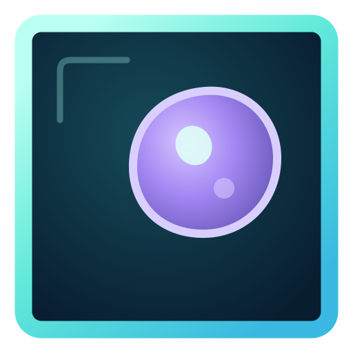

# Rellva Office

Rellva Office is a Windows app for managing local Codex chats, projects, and shared office floors. Each person uses their own account and controls their own workers.

- Message workers, manage project tasks, and assign coordinators.
- View your workers in a 3D office and visit friends’ shared floors.
- Save agent configuration versions and compare them with Simulation Trials.
- Train optional local model adapters in Model Workshop.
- Invite a friend’s worker to review material you choose to share.
- Open an approved local or privately paired desktop in a separate worker window.
- See available Codex usage information from your existing account.

## Install on Windows

1. **Install OpenAI’s desktop app and sign in with your own ChatGPT account.** Use the [official Windows guide](https://learn.chatgpt.com/docs/app/windows). Choose **Codex** for project chats; an existing signed-in Codex desktop installation can be used. [Official setup instructions](https://learn.chatgpt.com/docs/quickstart?setup=app).
2. **Download [Rellva-Office-Setup.exe](https://github.com/dpearce9009-hash/rellva-office/releases/latest/download/Rellva-Office-Setup.exe).** On the [release page](https://github.com/dpearce9009-hash/rellva-office/releases/latest), expand **Assets** and choose that filename. If you received **Rellva-Office-Friends.zip**, right-click it, choose **Extract All**, and open the extracted folder.
3. Finish current Rellva tasks and close Rellva before updating. Open **Rellva-Office-Setup.exe**; the installer installs for your Windows user and creates a shortcut. This preview is unsigned. If SmartScreen appears, confirm the file came from this repository before choosing **More info → Run anyway**.
4. Open **Rellva Office** from the Start menu. The connection indicator should read **Local Codex · saved chats**. If it says **Offline** or **Connection unavailable**, finish signing in to OpenAI’s desktop app, then choose **Access & controls → Refresh connection** in Rellva.

On first launch, choose **Connect this PC** to approve local desktop viewing, or **Not now** to skip it. You can connect later under **Access & controls → Desktops**. This grants no keyboard/mouse input or worker assignment.

The installer needs no separate API key. Each friend uses their own Codex sign-in and usage allowance. Python and local model setup are optional; they are needed only for Model Workshop and local model trials.

## Join a friend’s office

1. Ask the owner for their **private office invitation**. It is sent separately and is not included in the public download.
2. Open the invitation in your browser and choose **Open Rellva Office**. Allow your browser to open the app if asked.
3. In Rellva, choose **Join office**. Select a connected person’s floor to view their workers.

If the link does not open the app, choose **Access & controls → Join a room**. Paste the **entire invitation**, including everything after `#`, into **Room address**. Leave **Private token** blank when the invitation already includes it, then choose **Join office**.

Keep Rellva open while sharing your floor. Keep the invitation private; anyone with it can join that office.

## Workers and projects

Choose **Add worker** to use a saved chat or create a worker and select its project folder. Select the worker to open its room and message box. **Back** returns to the floor.

- **Tasks:** generate a plan, review proposed tasks, and use **Run** for manual tasks. Automatic queues need an explicit **Start auto** and a task limit.
- **Pause queue after task:** prevent more automated tasks for that worker after the current task finishes. **Stop worker** also interrupts work started in Rellva. **Pause all queues** and **Stop all tasks** apply across your workers; department controls show the affected worker count. Resuming permits work but does not start a queue.
- **Teams:** choose a coordinator and its workers. Approving a suggested assignment adds a task; it does not run it.
- **Project / Files:** inspect project progress and the worker’s saved files.

Idle office routines are visual animations. They do not run searches, complete project tasks, or spend model usage. Actual activity is indicated separately.

## Agent Lab and Simulation Trials

Open **Agent Lab → Projects**. Rellva, Compass, and RellvaA start as editable profiles. Select a project and saved version, edit its instructions, optionally choose its source folder, and choose **Save version**. Technical model, tool, and Git fields are under **Advanced profile settings**; local model selection is available in **Model Workshop**.

**Use this profile** selects a saved Lab configuration. It does not edit a production chat or copy the project’s source code. Git revision fields record metadata only. Tool configuration is saved metadata; text trials do not execute tools.

To compare versions:

1. Open **Simulation trials** and choose **New trial**.
2. Enter the trial name and input. Under **Check result**, choose **Review it myself**, **Matches this text exactly**, or **Contains this text**, then enter the expected result and time limit. Multiple checks, structured fixture data, and JSON-field or pattern checks are under **Advanced trial settings**.
3. Choose **Save trial version**.
4. Check the project versions to test. You can select several versions of the same project.
5. Choose **Run selected versions**, then open **Runs** to inspect actual output, timing, saved artifacts, and grades.

Runs execute one at a time and keep the exact trial and configuration versions used. **Compare selected** accepts only runs with the same fixture and checks. Exact, text, JSON-field, and bounded pattern checks use deterministic grading. Other quality judgments wait for **Owner review** and evidence. **Cancel** requests cancellation; the UI shows when the runner has actually stopped.

An empty model configuration uses the signed-in Codex account and requires an online connection. A profile explicitly pinned to a prepared Model Workshop model can run local text trials offline.

## Model Workshop — optional

Model Workshop trains local LoRA adapters and saves checkpoints. The app includes neither model weights nor a Python environment, and it downloads or installs neither automatically.

1. Choose **Model Workshop → Choose Python** and select a prepared Python environment containing PyTorch, Transformers, PEFT, and Safetensors. The app checks availability and reports missing packages.
2. Choose **Import folder** and select an existing local Transformers model folder with Safetensors weights. Supported model types are `llama`, `mistral`, `qwen2`, `qwen3`, `opt`, and `gpt2`. Custom-code, GGUF, pickle, and quantized model folders are not accepted by this recipe.
3. Create a dataset with at least three distinct examples. **Examples (JSONL)** accepts one `{"text":"..."}` or `{"prompt":"...","completion":"..."}` object per line. Choose **Save revision**.
4. Choose training settings and **Start training**. Inspect actual steps, loss, validation results, checkpoints, and any errors. **Cancel** stops a job; it does not turn incomplete output into a completed model version.
5. Choose **Base model** or a completed checkpoint and click **Select version**. Choose the target **Agent profile**, then **Save model to profile**. This saves a new Lab configuration version pinned to that model and checkpoint, preserving its other settings. It does not promote the profile or edit production chats. Opening Workshop from a Lab version selects that version as the target.

Return to **Agent Lab → Simulation trials** and check the newly saved profile version to test it. **Roll back** restores the prior Workshop selection; saved Lab versions keep their pinned model configuration.

The unquantized FP32 base must fit the selected CPU or CUDA device’s memory. Supported file format alone does not guarantee that a model will fit or train successfully.

## Review Sessions

Both people must be in the same office with review support enabled.

1. Open **Review Sessions**, select your worker and your friend’s worker, and write a brief. Add only the excerpts and reference descriptions or public links you want reviewed.
2. Choose **Preview invitation**. Inspect the shared material, then choose **Send invitation**. Preparing or viewing a preview sends nothing.
3. Your friend chooses **Review invitation**, inspects it, and chooses **Accept & run** or **Decline** for their own worker.
4. Findings stay private on the reviewing owner’s computer. That owner chooses a response excerpt, uses **Preview response**, and then chooses **Share response**.

Reviews use an isolated text session. A review grants no control over another owner’s workers or desktop and applies no production edits. Other floors do not receive the brief or findings. Shared review payloads are limited to 48 KB.

## Worker desktop windows

For this PC, open **Access & controls → Desktops → Connect this PC** and approve the Windows dialog. Select your worker, choose **Assign desktop**, then choose the computer and display. **View desktop** opens its separate window.

- **Take control:** pauses the worker’s desktop input. For this PC, use Windows directly; the viewer does not send your input back into the same screen. For a paired remote PC, click the viewer to use its mouse and keyboard.
- **Let worker work:** separately grants the selected worker input access. Minimize a local viewer while the worker uses this PC.
- **Pause / Stop / Close:** remove that window’s input access. **Stop** also interrupts the worker’s active Rellva turn.

Opening a viewer alone grants no input access. Watching a shared office floor grants no desktop access.

### Pair another PC

Both PCs need Rellva Office open and must join the **same private office**. Pairing is optional and uses a separate private invitation.

1. On the PC being shared, open **Access & controls → Desktops**. Enter a PC name under **Share this PC**, then choose **Share this PC**.
2. In its new pairing row, choose **Copy pairing**. Send that private invitation to the other PC’s owner.
3. On the other PC, paste it into **Private pairing invitation** under **Connect another PC**, choose **Connect another PC**, and confirm the Windows dialog.
4. On the shared PC, choose **Approve viewing**, select the displays, choose **Approve**, and confirm the Windows dialog. Viewing lasts up to eight hours, bounded by the pairing’s expiry.
5. To permit keyboard and mouse input, the shared PC’s owner separately chooses **Allow control 5 min**, selects the displays, and approves. On the other PC, assign that paired computer to a worker and open **View desktop**. Choose **Take control** for yourself or **Let worker work** for that worker.

**Stop control** removes keyboard and mouse permission while retaining approved viewing. **Revoke** removes the pairing. After a connection loss, **Reconnect** requires fresh host approval; prior permission is not restored automatically. Approving remote input pauses local worker desktop control. Taking local desktop control removes remote input permission.

Desktop traffic is encrypted between the paired apps. The relay routes it, and other office members do not receive it. Keep pairing invitations private; they are not included in shared floors or public downloads.

## Usage & credits

**Usage & credits** reads available Codex allowance, reset, and token activity information from your existing local account connection. No additional setup is needed. Fields the account service does not provide are shown as unavailable.

API balance and API spending are currently **Unavailable** in the app. **Open API balance** and **Open API spending** open the account’s billing pages. Codex workspace credits are not an API billing balance.

## Sharing, updates, and current limits

Shared floors show selected worker names and activity. Conversation excerpts are shared only when that option is enabled. Each owner controls their own workers, approvals, files, goals, and task lists. Desktop viewing or input requires the separate pairing approvals above. Service sign-ins and private project data are not included in the installer.

This preview uses **local Codex chats**; it does not import every cloud-only ChatGPT conversation. If another active session owns a chat, finish its work and fully quit that source app before continuing the chat in Rellva, or create a separate worker.

The installed app checks for updates. You can also choose **Access & controls → Check updates**. Shared floors require the participating apps to remain open; persistent building accounts are not included.

